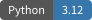
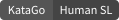

<p align="center"><a href="README.md"></a> <a href="README.en.md"></a></p>

<h1 align="center">AI CUP 2026 秋季賽<br>圍棋棋力與風格預測競賽</h1>

<p align="center">
  
  
  
  <a href="LICENSE"></a>
</p>

<p align="center">兩個子競賽的完整程式碼：資料處理、模型訓練、推論，以及最終提交檔的重現檢查。</p>

## 競賽與成績

| | 競賽 | 隊伍 | Private Leaderboard | 程式碼 |
|:---:|---|:---:|:---:|:---:|
| 一 | 從圍棋棋譜集辨識玩家 | TEAM_11307 | **0.923441**（第 4 名） | [`comp1/`](comp1/) |
| 二 | 從圍棋棋譜預測玩家棋力等級 | TEAM_11306 | **0.789846**（第 6 名） | [`comp2/`](comp2/) |

每個競賽資料夾都有自己的 README，說明環境安裝、資料放置、執行順序、重要模組的輸入與輸出，以及如何重現最終提交檔。

## Repo 結構

```text
aicup2026-go/
├── comp1/         競賽一：玩家辨識（程式、設定、README）
├── comp2/         競賽二：棋力等級預測（程式、設定、README）
├── third_party/   共用的第三方程式碼：KataGo 模組、sgfmill
└── LICENSE        MIT
```

## 快速開始

**1. 取得程式碼**

```bash
git clone https://github.com/AuricTW/aicup2026-go.git
cd aicup2026-go
```

**2. 下載權重**：到 [Releases v1.0](https://github.com/AuricTW/aicup2026-go/releases/tag/v1.0) 下載附件，放在 repo 根目錄。

| 附件 | 大小 | 解開位置 |
|---|---:|---|
| `comp1_weights.tar.part00`～`part02` | 3.99 GB（三段） | 接回成 `comp1_weights.tar` 後解開到 `comp1/` |
| `comp2_weights.tar` | 553 MB | 解開到 `weights/comp2/` |
| `SHA256SUMS.txt` | — | 各附件的 SHA-256 |

```bash
cat comp1_weights.tar.part0* > comp1_weights.tar
# Windows cmd：copy /b comp1_weights.tar.part00+comp1_weights.tar.part01+comp1_weights.tar.part02 comp1_weights.tar
sha256sum -c SHA256SUMS.txt --ignore-missing
tar -xf comp1_weights.tar -C comp1/
mkdir -p weights/comp2 && tar -xf comp2_weights.tar -C weights/comp2/
```

**3. 重現最終提交檔**（各 README 第 6 節有完整說明）

| 競賽 | 最快的重現層級 | 指令 | 預期 SHA-256 |
|---|---|---|---|
| 一 | L1：存下的最終分數矩陣 → CSV（CPU） | `python scripts/report_repro_20261125_v1.py check`（在 `comp1/` 執行；同時跑 L2，L2 需先重建官方資料衍生檔） | `b3df6a05…fe82ad` |
| 二 | R1：91 個成員後驗 → CSV（CPU 數秒） | `python src/blend_final.py --parts ../weights/comp2/parts --out out.csv`（在 `comp2/` 執行） | `1ADC681D…04CA4A` |

## 資料與權重

- **官方資料**：請從主辦單位的 [aicup2026-go-dataset](https://github.com/AILAB-NDHU/aicup2026-go-dataset) 下載，本 repo 不附原始資料。
- **由官方資料重新編碼的檔案**（落子序列、帳號標籤、測試棋局包等）不隨 Release 提供。各 README 附有重建指令，重建結果已驗證和原檔逐位元組相同。
- **模型權重**放在 GitHub Releases，不進 git。各檔的大小與 SHA-256 列在 `comp1/weights_manifest.tsv`、`comp2/weights_manifest.tsv`。

## 授權

本隊程式碼採 [MIT 授權](LICENSE)。`third_party/` 內的 KataGo 與 sgfmill 保留各自的原授權；KataGo Human SL 網路權重依 KataGo Neural Network License 使用，授權全文附在 Release 內。
